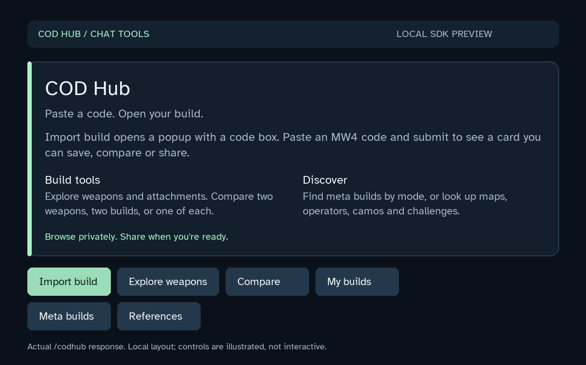
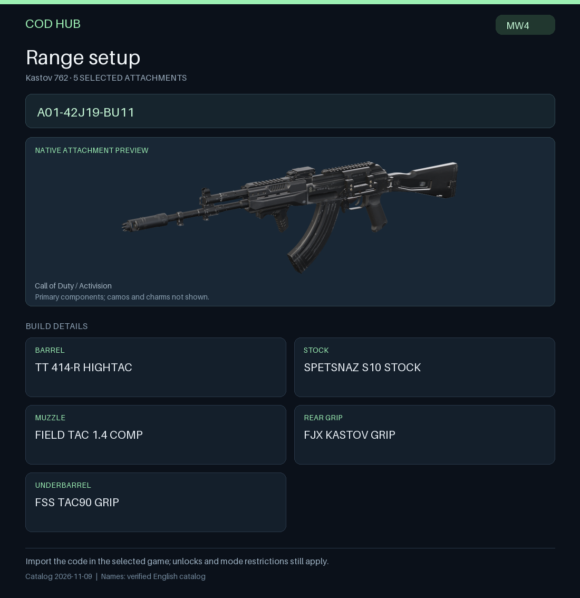
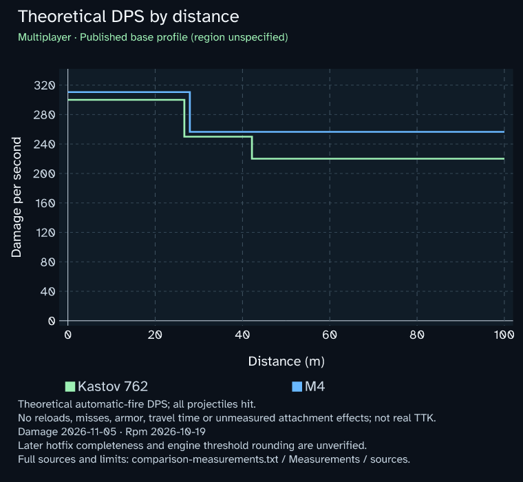

# COD Hub


COD Hub brings Call of Duty build codes, weapon browsing, comparisons and saved loadouts into Discord through YourBot. Start with `/codhub`, then use the cards and menus or jump directly to a slash command.



## What it does

- Choose Import code, paste a native MW4 code into the Discord popup and submit to generate a private card with named attachments and a copyable code.
- Explore weapons and their attachments; save, rename and delete your own builds in each server.
- Share a build card or PNG to the current channel when you choose to post it. PNGs include bundled native previews where a reviewed image is available.
- Choose two weapons in the guided A/B picker, or paste build codes to compare builds or one of each. Switch between overview, DPS, recoil, aiming sway and measurement sources.
- Browse attributed Multiplayer and Warzone meta recommendations by weapon type. DMZ currently links to an external dedicated source.
- Search dated COD Wiki references for maps, operators, camos, challenges, prestige, perks and equipment.

Build cards prefer transparent native previews for 17 weapons. Three verified Kastov codes have their own primary attachment-layout previews: `A01-42J19-BU11`, `A01-A11NP-B11` and `A01-9YGBJ-D11`. Other builds use a clearly labeled base preview where available. Camos, charms, every runtime component and full game shader appearance are not reproduced. Remaining weapons retain attributed provider artwork or text-only cards.

The [weapon preview gallery](https://ember-kace.github.io/yourbot-plugin-codhub/artwork/) is hosted free on GitHub Pages. The same 20 lossless transparent WebPs are bundled with the plugin for PNG exports: 2,001,102 bytes total, 43.86% smaller than their PNG sources with identical decoded pixels. Private Discord cards use the hosted HTTPS images because YourBot SDK 0.10.1 does not expose file attachments on private interaction replies. PNG exports read the bundled copies without an image-host request. [GitHub Pages availability](https://docs.github.com/en/pages/getting-started-with-github-pages/what-is-github-pages), [YourBot API](https://yourbot.gg/docs/developers/reference/context).

| Build card | DPS comparison |
|---|---|
|  |  |

See [the usage guide](docs/USAGE.md) for all eight commands, sharing controls and data limits. These are locally rendered demonstrations, not screenshots of a live Discord installation.

If **Import code** fails before a popup appears, use `/codbuild code:A01-42J19-BU11` to test import directly. A live installation has returned an unexplained Discord HTTP 400 for the popup request; this remains under investigation. Version 0.1.4 adds specific recovery messages and safe diagnostics, rather than treating this as an invalid build code. See [popup troubleshooting](docs/USAGE.md#installation-and-troubleshooting).

## Install through YourBot

1. Build `COD-Hub-0.1.5.zip` from this checkout using the commands below, or download an available package from [GitHub Releases](https://github.com/ember-kace/yourbot-plugin-codhub/releases). The ZIP contains `manifest.json` and `__main__.py` at its root.
2. To publish your own installation package, sign in to the [YourBot Dev Portal](https://yourbot.gg/dev), use the plugin ID assigned there, upload the validated ZIP and follow the review process. Upload the ZIP contents as built; do not upload this whole repository. [Official publishing guide](https://yourbot.gg/docs/developers/production/publish).
3. Once a version is available to install, use the Marketplace in your custom-bot server's YourBot dashboard, review its permissions and domains, and allow its commands through Command Access. Then run `/codhub` in Discord. [Official installation guidance](https://yourbot.gg/docs/platform/marketplace-plugins).

This repository uses a `plugin/` source directory. The documented artifact workflow is ZIP upload; the public YourBot guidance does not establish GitHub-pull subdirectory support. A public GitHub repository does not itself publish or install a YourBot plugin.

The supplied manifest targets COD Hub's assigned platform ID, `rmg84ete7r8b`. If you create a separate plugin in the Dev Portal, replace `manifest.json`'s `id` with that plugin's assigned ID and package it with `python tools/package_plugin.py --plugin-id YOUR_ASSIGNED_ID --output dist/COD-Hub.zip`. The platform ID must match the upload destination. YourBot assigns the uploaded version independently of the GitHub release tag.

## Develop and package

Use Python 3.10 or newer. Create and activate a virtual environment, then install the pinned development dependencies:

```sh
python -m venv .venv
# Activate .venv using your shell's usual command.
python -m pip install -r requirements-dev.txt
python tools/dev.py test
python tools/dev.py validate
python tools/dev.py package
```

The package command writes `dist/COD-Hub-0.1.5.zip` from an explicit runtime file list, checks the captured Python files for disallowed imports and dynamic code, verifies the native image hashes and packaged resources, and validates it with YourBot SDK 0.10.1 against COD Hub's assigned ID. To also pin the expected manifest version before upload, use `python tools/package_plugin.py --version 0.1.5`. These local checks supplement the portal's separate security scan; they do not predict its risk score. The SDK also supplies `yourbot validate --path plugin --id rmg84ete7r8b --version 0.1.5` and `yourbot doctor --path plugin`. Review the [current YourBot developer documentation](https://yourbot.gg/docs/developers) before changing platform APIs or dependencies.

Optional: `python tools/dev.py preview` generates local card demonstrations. No game installation, player credentials or Discord bot token is needed for the offline tests and build tools. A live menu has been observed; popup import remains blocked by the HTTP 400 described above. Offline and simulated-transport success does not establish live Discord compatibility.

## Data coverage and accuracy

The November 9, 2026 snapshot retains 1,264 catalog assets and 35 weapon-reference records: 1,216 verified names plus 83 separately marked internal or technical descriptions. Descriptions preserve otherwise unnamed identities; they are not canonical game names and are excluded from normal player-item searches. The player-facing weapon browser has 35 named weapons: 17 native previews, 11 additional provider images, and 7 text-only cards.

Reviewed theoretical DPS currently covers five automatic **base weapons in Multiplayer**: Kastov 762, M4, Patriot XMR, ISO Nightshade and Type 73. Damage is dated November 5, 2026; RPM is from the October 19 launch reference. The source's base hit region is unspecified. Modified-build DPS, DMZ/Warzone damage, recoil and aiming-sway measurements remain unavailable until comparable measurements are reviewed. No performance curve is inferred from UI bars.

Meta recommendations are provider opinions and can change. Wiki results are attributed article references, not a complete structured catalog or a guarantee of current game facts. COD Hub does not retrieve player statistics, match history or account unlocks.

## Permissions and privacy

The plugin requests `interaction:respond`, `storage:kv`, `discord:send_message` and `proxy:http`. HTTP requests are limited to `metaradar.gg` and `callofduty.fandom.com`. It does not subscribe to ordinary channel messages or request moderation permissions.

Saved builds contain your Discord user identifier, build code, title and creation time in YourBot's server-scoped plugin storage. Previews expire after seven days; saved builds persist until deleted. Browsing and import previews are private. **Post to channel**, **Post PNG to channel** and **Post graphs to channel** deliberately publish to the current channel. Reference search terms are sent to COD Wiki through YourBot's proxy; weapon images are loaded by Discord from GitHub Pages or the attributed provider. Static image URLs contain content hashes, not user titles or account identifiers.

## Sources and rights

COD Hub is an unofficial community project, unaffiliated with Activision, Call of Duty or YourBot. Call of Duty and related names and artwork belong to their respective owners. Cards preserve factual-source links and dates, native-preview credits, MetaRadar attribution where used, and COD Wiki revision/contributor/license information. Only the reviewed rendered previews are bundled; raw game packages, models, textures and private extraction receipts are excluded.

No project license granted. Third-party licenses/notices apply to their respective resources. See [THIRD_PARTY_NOTICES.md](THIRD_PARTY_NOTICES.md).
