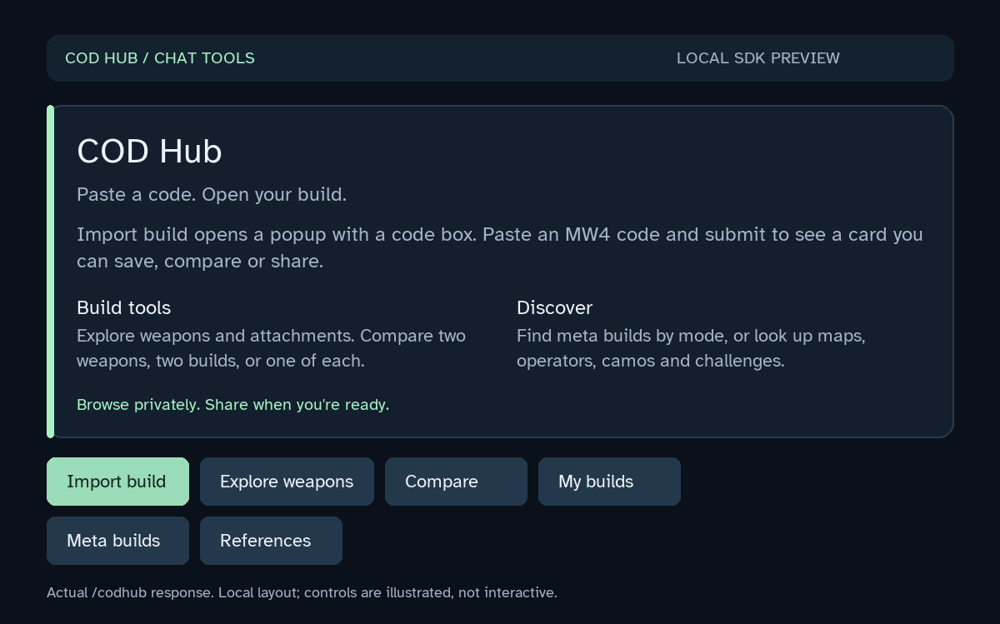
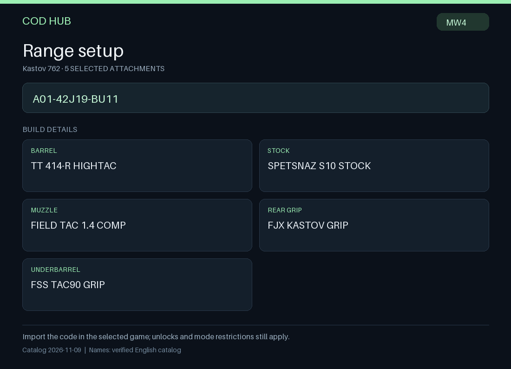
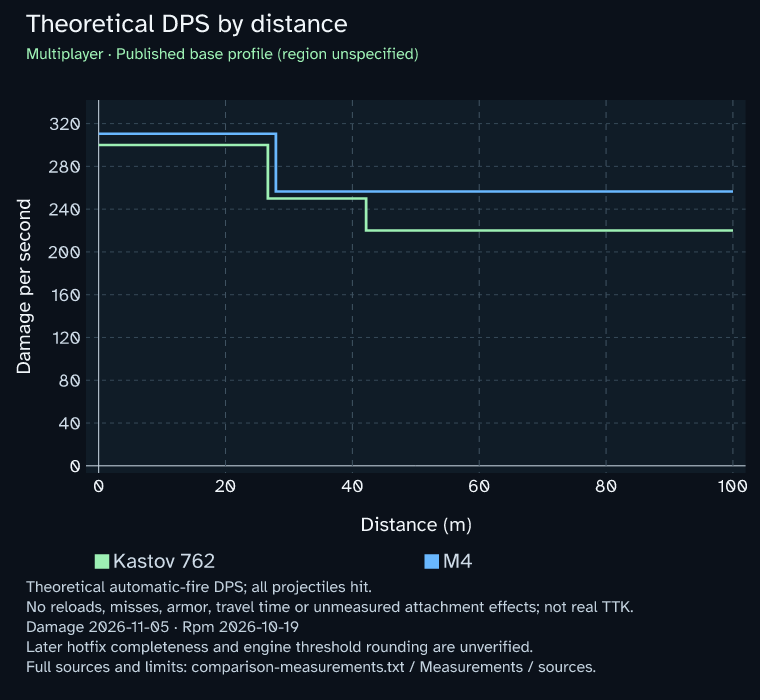

# Using COD Hub

Run `/codhub` to post the shared home card. Its first row opens Import code, My builds and Compare; the second opens Weapons, Meta builds and Game guide. Each person's browsing and previews are private. Personal saved counts and builds stay off the shared launcher. The plugin works through Discord cards, popup forms and slash commands; there is no separate plugin dashboard.



## Commands

The command names and options below match `plugin/manifest.json`.

| Command | Options | Result |
|---|---|---|
| `/codhub` | None | Shared home card with entry points into private tools. |
| `/codbuild` | Required `code`; optional `game:mw4`, `title` | Decode a native MW4 code into a private build preview. |
| `/codweapon` | Required `query`; optional `game:mw4` | Search the packaged weapon catalog by name, reference or prefix. |
| `/codattachment` | Required `query`; optional `weapon`, `game:mw4` | Search named attachments; a prefix such as `A01` narrows the weapon. |
| `/codsaved` | Optional `action:list\|show\|delete`, `id`, `page` | Manage your builds in this server. Show/delete use an ID from your saved list. |
| `/codcompare` | Required `left`, `right`; optional `mode`, `view` | Compare weapon names, prefixes or supported native MW4 codes. |
| `/codmeta` | Optional `mode`, `weapon_type` | Private mode/type browser for attributed recommendations. |
| `/codreference` | Required `query`; optional `category`, `game` | Private, dated COD Wiki article search. |

Build and catalog commands currently accept only the MW4 game catalog. Reference search also offers BO7 and Warzone search terms. This does not add native build-code support for those games.

## Import, save and share

1. Choose **Import code** on the home card or in My builds. A Discord popup opens with a **Paste build code** box and an optional build name. Paste a native MW4 code, then submit the form to generate your private card. You do not need another slash command. Alternatively, run `/codbuild` and paste the code into its `code` option.
2. Check the private weapon/attachment card. **Save** creates your own saved copy. **Show code** displays private copyable text for the game's own import flow.
3. Use **Post to channel** or **Post PNG to channel** when you want to publish to the current channel. These posting controls have their own row, separate from saved-build utilities and navigation. A shared build lets other people save their own copy or explore its weapon.



Open **My builds** or `/codsaved` to select a saved build. **Rename** opens a form; the card's **Delete** button asks for confirmation. The `/codsaved action:delete` command directly deletes the named saved record. Posting and changing saved copies remain owner-bound.

Saved builds persist independently of previews. Preview controls expire after seven days and may be replaced sooner in the bounded preview cache. Re-import a code if an old preview has expired. The library has an advisory limit of 50 builds per person per server; simultaneous saves on separate workers can exceed that limit, so all retained records remain manageable.

Codes represent a build selection; they do not unlock items or verify your account's inventory. An unsupported or unnamed selection is rejected with an explanation. Existing affected saved records still permit code retrieval and deletion. Weapon art represents the base model, not the selected attachment configuration. Missing art leaves a usable text card; exported build PNGs are text-only.

## Explore weapons

Choose **Weapons** to filter by class, page through named weapons and open weapon-specific attachment cards. Search, Back and Home controls keep navigation inside chat. Reference-only weapons do not expose unsupported build or attachment controls.

Internal and technical descriptions are kept separate from verified game names. They are not presented as selectable attachment names. Native identity retention is broader than the set of builds the plugin will present as a fully named player build.

## Compare weapons or builds

Open **Compare** from the home card, a weapon card or a build card:

1. Choose **A** or **B**, then pick a weapon from the dropdown. Use the class filter and page buttons to find it. Opening Compare from a weapon or build keeps that selection as A.
2. Once both sides are selected, choose **Compare A / B**. For builds or exact names, **Paste names / codes** opens a popup where you can enter both sides instead.
3. The result starts in Multiplayer. Switch mode, comparison view and available hit location from its menus. The view menu offers Overview, Measurements / sources, and only compatible reviewed graph views. Missing measurements are explained on the card; they do not prevent an overview comparison.

If one pasted input is invalid, the private setup identifies A or B and keeps the valid side selected. Choose the missing weapon and compare again. Compare becomes the primary action once both selections are ready.

The slash alternative is `/codcompare left:<weapon or code> right:<weapon or code>`, with optional `mode` and `view` options.

| View | What it shows |
|---|---|
| `overview` | Dated base references and attachment differences. |
| `dps` | Reviewed theoretical damage per second by distance, when both selections have compatible measurements. |
| `recoil` | Recoil/gun-kick measurement view; currently unavailable without reviewed compatible data. |
| `sway` | Aiming-sway measurement view; currently unavailable without reviewed compatible data. |
| `details` | Paged full selections, measurement conditions, units, source links, dates and limitations. |



Current numerical DPS support is limited to five automatic base weapons in Multiplayer: Kastov 762, M4, Patriot XMR, ISO Nightshade and Type 73. The model combines official damage dated November 5, 2026 with launch RPM dated October 19, 2026. Base hit region is unspecified; Head is offered only when both profiles report it. This is theoretical DPS, not a measured time-to-kill or a promise that those values apply after later balance changes.

Attachment performance is not inferred from names or UI stat bars. Modified builds, other modes, recoil and sway show an unavailable state when matching reviewed measurements are missing. Overview remains useful for selections without numerical coverage.

**Post to channel** publishes a comparison to the current channel. **Post graphs to channel** publishes available plots and a `comparison-measurements.txt` attachment containing their complete sources and caveats. Posting a comparison remains available when measurements are missing; graph posting requires reviewed compatible data. Anyone can open private measurement details from a shared comparison. Shared graph controls switch only among the reviewed plots attached to that post.

## Meta and reference sources

**Meta builds** on the home card opens a mode chooser for Multiplayer, DMZ, Warzone and BO7. `/codmeta` offers Multiplayer, DMZ and Warzone plus weapon-type filters: all, AR, BR, SMG, LMG, shotgun, sniper, marksman, pistol, launcher and melee. Multiplayer and Warzone use attributed [MetaRadar](https://metaradar.gg/) snapshots with at most hourly refreshes. Ranks, source dates and stale-state notices are retained. DMZ currently provides an external [DMZ Radar](https://dmzradar.com/meta.html) link rather than an in-card feed. MW4 build import remains a separate feature.

**Game guide** or `/codreference` searches [COD Wiki](https://callofduty.fandom.com/) article excerpts. Category choices are all, maps, operators, camos, challenges, prestige, perks and equipment. Game choices are all, MW4, BO7 and Warzone. These options add search terms; verify the result's actual game and revision. Each result retains contributor credit, revision links and source-license information. Searches refresh at most every 12 hours and do not fetch wiki artwork.

These are references and provider recommendations, not complete structured databases of maps, operators, progression or challenges. Player statistics and match history are not connected.

## Privacy and permissions

Import previews, weapon/attachment results, saved-library views, comparisons, meta browsing and reference searches are private. The home card and deliberate share/post actions are public in their current channel. Do not put personal information into a title you intend to share.

YourBot stores saved build records under the current server/plugin namespace, with the owner's Discord identifier, code, title and creation time. Delete saved builds from their controls or `/codsaved`. Previews expire; saved records have no automatic expiry.

The four declared capabilities are interaction responses, durable KV storage, Discord message sending and HTTP proxy access. The two proxy domains are `metaradar.gg` and `callofduty.fandom.com`. Reference queries leave the plugin through that proxy; images are loaded by Discord from provider URLs. No Activision credentials, player-data API key, ordinary message-content access or moderation permission is requested.

Offline code decoding, weapon browsing, saved-build management, build PNGs and supported comparison charts use packaged data. YourBot/Discord connectivity is still required to use them in chat. Provider outages affect live meta/reference requests and remote art, not the packaged catalog.

## Installation and troubleshooting

See the [README](../README.md#install-through-yourbot) for the ZIP publishing and Marketplace installation path. The server must satisfy YourBot's custom-bot requirements. Review permissions and Command Access in the YourBot dashboard if commands are unavailable. Slash-command changes follow the version installed on that server, so check its installed version before assuming an update has propagated. [Official Marketplace guidance](https://yourbot.gg/docs/platform/marketplace-plugins).

If a code is rejected, check that it is a native MW4 code and re-copy it without extra text. If a saved-build control expires, reopen the library or import the code again. If a numerical comparison is unavailable, open Measurements / sources to see which profile or condition is missing.

If **Import code** fails immediately before the popup appears, the code has not reached the decoder. Use the direct command:

```text
/codbuild code:A01-42J19-BU11
```

This sample resolves to Kastov 762 with five attachments. Search and references also have direct `/codweapon query:Kastov` and `/codreference query:Terminal` alternatives. Comparison retains its guided weapon picker when its paste form is unavailable.

A live popup attempt returned `Discord API error 400` for `interaction.send_modal`, without Discord's response body. The current official SDK 0.10.1 serializes the request into legacy action rows. [Discord now recommends Label containers instead](https://docs.discord.com/developers/components/reference#text-input); whether that deprecation is related to this rejection is unconfirmed. The local transport tests simulate the host and cannot explain the live rejection. Version 0.1.4 improves recovery and logs the form, SDK version, error class/code and HTTP status without raw error text, user input or interaction credentials. It does not claim to repair the live popup rejection.

For YourBot support, report that the first response to the `chh:import` component is `send_modal(title="Import MW4 build code", custom_id="chh:import:v1", fields=[TextInput("Paste build code", "code", min_length=7, max_length=256), TextInput("Build name (optional)", "title", required=False, max_length=80)])`. There is no preceding defer. Ask them to inspect the host's modal payload and the complete Discord HTTP error response, with tokens redacted. The request follows the [official modal API](https://yourbot.gg/docs/developers/build/modals). A missing response body does not establish whether the cause is host translation, acknowledgment state or another Discord validation error.

Local regression and SDK validation do not replace a real server installation test. A live menu has been observed, while popup import remains unresolved as described above. No project license granted; see [third-party notices](../THIRD_PARTY_NOTICES.md) for resources with their own terms.
